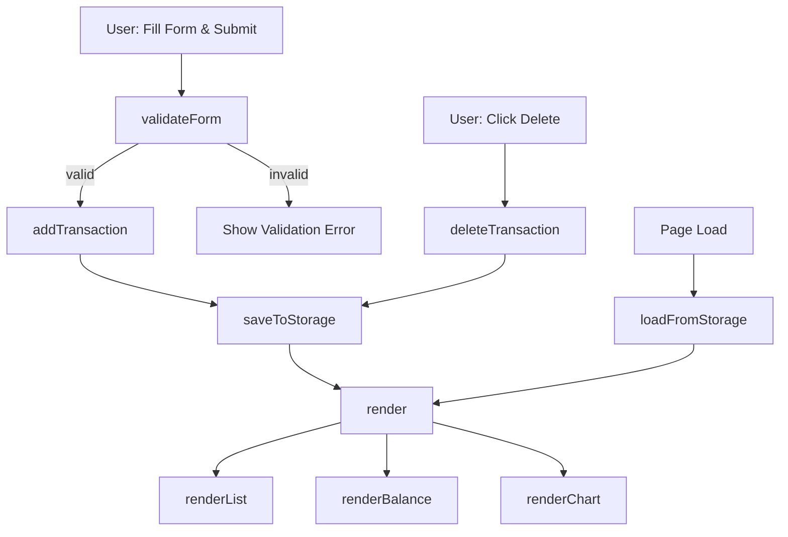

# Design Document

## Overview

The Expense & Budget Visualizer is a self-contained, client-side single-page application (SPA) built with plain HTML, CSS, and Vanilla JavaScript. It allows users to record personal expense transactions, view them in a scrollable list, track a running total balance, and visualise category-level spending in a pie chart — all without a server, build tool, or package manager.

All state is persisted to the browser's `localStorage` as a serialised JSON array of transaction objects. The chart is rendered by [Chart.js](https://www.chartjs.org/) loaded via a CDN `<script>` tag, so no npm install is needed.

The entire application logic lives in a single JavaScript file (`js/app.js`), styles in a single CSS file (`css/style.css`), and the HTML entry-point at the project root (`index.html`).

---

## Architecture

The app follows a **unidirectional data-flow** pattern inside a single JS file:

```
User Interaction
      │
      ▼
 Event Handlers  (form submit, delete button click)
      │
      ▼
 State Mutation  (add / remove from in-memory transactions array)
      │
      ▼
 Persistence     (write full array to localStorage)
      │
      ▼
 Render          (re-render list, balance, pie chart from current state)
```

There is no virtual DOM and no reactive framework. Each mutating action calls a single `render()` orchestrator that redraws the three output components from the current in-memory state array. This keeps the data flow predictable and easy to debug.



---

## Components and Interfaces

All components are plain DOM elements wired by JavaScript functions. There are no classes or modules — the file uses a small set of well-named functions and a single shared state variable.

### State

```js
// In-memory array; source of truth for all rendering
let transactions = []; // Transaction[]
```

### Input Form (`#expense-form`)

| Element | Role |
|---|---|
| `#item-name` | Text input for the transaction name |
| `#amount` | Number input for the transaction amount |
| `#category` | `<select>` with options: Food, Transport, Fun |
| `#submit-btn` | Form submit trigger |
| `#form-error` | Inline error message container (hidden by default) |

**Public interface (functions):**

```js
function validateForm(name, amount, category): { valid: boolean, errors: string[] }
function resetForm(): void
function showFormError(message: string): void
function hideFormError(): void
```

### Transaction List (`#transaction-list`)

A `<ul>` rendered by iterating over `transactions`. Each `<li>` contains the name, amount, category, and a delete `<button data-id="...">`.

```js
function renderList(transactions: Transaction[]): void
```

### Balance Display (`#balance`)

A single `<span>` or `<p>` that shows the sum of all transaction amounts, formatted as `$0.00`.

```js
function renderBalance(transactions: Transaction[]): void
function formatCurrency(amount: number): string  // → "$1,234.56"
```

### Pie Chart (`#spending-chart`)

A `<canvas>` element managed by a Chart.js `Pie` instance. The chart is created once and updated (not recreated) on every render call to avoid flickering.

```js
let chartInstance = null; // Chart | null

function renderChart(transactions: Transaction[]): void
function buildChartData(transactions: Transaction[]): { labels: string[], data: number[], colors: string[] }
```

### Local Storage

```js
const STORAGE_KEY = 'expense_visualizer_transactions';

function saveToStorage(transactions: Transaction[]): void
function loadFromStorage(): Transaction[]        // returns [] on parse error or missing key
```

### Render Orchestrator

```js
function render(): void  // calls renderList, renderBalance, renderChart with current transactions
```

---

## Data Models

### Transaction

```ts
interface Transaction {
  id: string;        // UUID-style unique ID, e.g. crypto.randomUUID() or Date.now().toString(36)
  name: string;      // Item name, non-empty string
  amount: number;    // Positive number, stored as a float
  category: 'Food' | 'Transport' | 'Fun';
}
```

**localStorage serialisation:** The `transactions` array is stored under the key `expense_visualizer_transactions` as a JSON string:

```json
[
  { "id": "abc123", "name": "Lunch", "amount": 12.50, "category": "Food" },
  { "id": "def456", "name": "Bus pass", "amount": 30.00, "category": "Transport" }
]
```

**Category colour mapping** (used by the pie chart):

```js
const CATEGORY_COLORS = {
  Food:      '#FF6384',
  Transport: '#36A2EB',
  Fun:       '#FFCE56',
};
```

---

## Correctness Properties

*A property is a characteristic or behavior that should hold true across all valid executions of a system — essentially, a formal statement about what the system should do. Properties serve as the bridge between human-readable specifications and machine-verifiable correctness guarantees.*

### Property 1: Serialisation round-trip preserves all transaction data

*For any* array of valid transactions, serialising the array to localStorage and then deserialising it must produce an array of equal length whose entries each have the same `id`, `name`, `amount`, and `category` as the original.

**Validates: Requirements 1.2, 6.1, 6.2, 6.3**

### Property 2: Invalid input is rejected and leaves state unchanged

*For any* form submission where the name is composed entirely of whitespace characters, or the amount is zero, negative, or non-numeric, `validateForm` must return `valid: false` and the transactions array must remain unchanged in length and content.

**Validates: Requirements 1.3, 1.4**

### Property 3: Balance equals the arithmetic sum of all amounts

*For any* array of transactions, `formatCurrency(sum)` where sum is the total of all `amount` fields must equal the value shown by the balance display — a string that starts with a currency symbol and whose numeric part equals the exact arithmetic sum rounded to two decimal places.

**Validates: Requirements 4.1, 4.3, 4.4**

### Property 4: Delete removes the transaction from both state and storage

*For any* transactions array and any transaction in that array, after calling `deleteTransaction` with that transaction's `id`, the resulting in-memory array must contain no entry with that `id`, and deserialising the updated localStorage value must also contain no entry with that `id`.

**Validates: Requirements 3.1, 3.2**

### Property 5: Rendered list items expose all required fields and a delete control

*For any* array of transactions, calling `renderList` must produce one list item per transaction, and each item must contain the transaction's `name`, `amount`, `category`, and a delete button whose `data-id` attribute equals the transaction's `id`.

**Validates: Requirements 2.1, 2.5**

### Property 6: Pie chart data matches per-category totals

*For any* non-empty transactions array, `buildChartData` must return a `labels` array containing exactly the distinct categories present in the transactions, and each corresponding `data` value must equal the sum of `amount` for all transactions in that category.

**Validates: Requirements 5.1**

---

## Error Handling

| Scenario | Handling |
|---|---|
| `localStorage` unavailable (private-browsing quota, SecurityError) | Catch the exception in `saveToStorage`; display a non-blocking banner. App still works in-memory for the session. |
| `localStorage` contains malformed JSON | `JSON.parse` is wrapped in try/catch inside `loadFromStorage`; return `[]` and show the same non-blocking banner. |
| `crypto.randomUUID` unavailable (older Safari) | Fall back to `Date.now().toString(36) + Math.random().toString(36).slice(2)` for ID generation. |
| Chart.js CDN unavailable | The `<canvas>` remains blank; all other features (list, balance, storage) continue to work. A `window.onerror` handler logs the failure. |
| Amount field receives non-numeric string | `validateForm` checks `isNaN(parseFloat(value))` before creating a transaction; shows an inline error. |

---

## Testing Strategy

Because this feature is a pure client-side UI application with no algorithmic data-transformation layer beyond arithmetic and JSON serialisation, only a subset of acceptance criteria are suitable for property-based testing. The pure utility functions (`validateForm`, `formatCurrency`, `buildChartData`, `loadFromStorage`/`saveToStorage`) are the testable core; DOM interactions are covered by example-based tests.

### Unit and Property Tests (Jest + fast-check)

The following functions are pure or near-pure and are extracted for unit/property testing:

| Function | Test type |
|---|---|
| `validateForm` | Property (whitespace names, invalid amounts, all three categories) |
| `formatCurrency` | Property (any non-negative number produces `$X.XX`) |
| `buildChartData` | Property (labels match distinct categories, data matches sums) |
| JSON round-trip via `saveToStorage` / `loadFromStorage` | Property (deserialise ∘ serialise = identity) |
| `deleteTransaction` (pure array logic) | Property (resulting array excludes deleted id, length decreases by 1) |

**Property test configuration:**

- Library: [fast-check](https://fast-check.dev/) (no install required for plain JS testing; a devDependency only for running tests, not for the production app)
- Minimum 100 iterations per property
- Tag format: `// Feature: expense-budget-visualizer, Property N: <property text>`

### Example-Based / Integration Tests

| Scenario | Test type |
|---|---|
| Form submits and list updates in DOM | Example (jsdom + Jest) |
| Balance shows `$0.00` with no transactions | Example |
| Delete control removes item from DOM | Example |
| Page load reads from mocked localStorage | Example |
| localStorage unavailable — banner appears | Example (mock `localStorage.setItem` to throw) |
| Pie chart renders without error on empty list | Example |

### Browser Compatibility

Manual smoke tests in Chrome, Firefox, Edge, and Safari cover:

- Page load and initial render
- Add, delete, and reload cycle
- Chart rendering with Chart.js CDN
